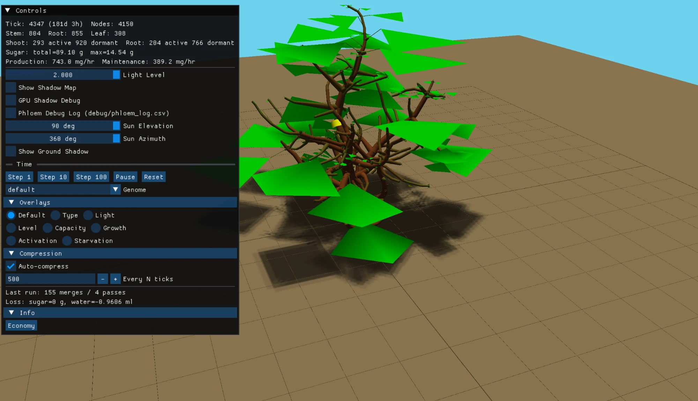
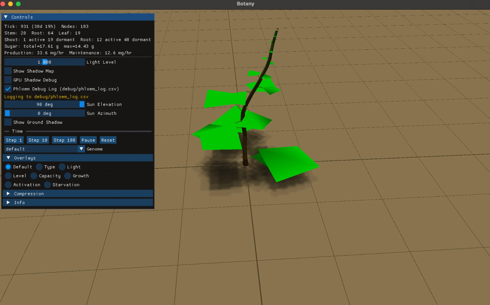
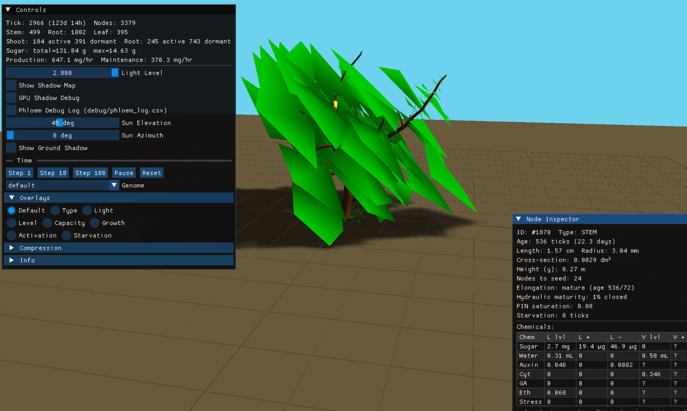
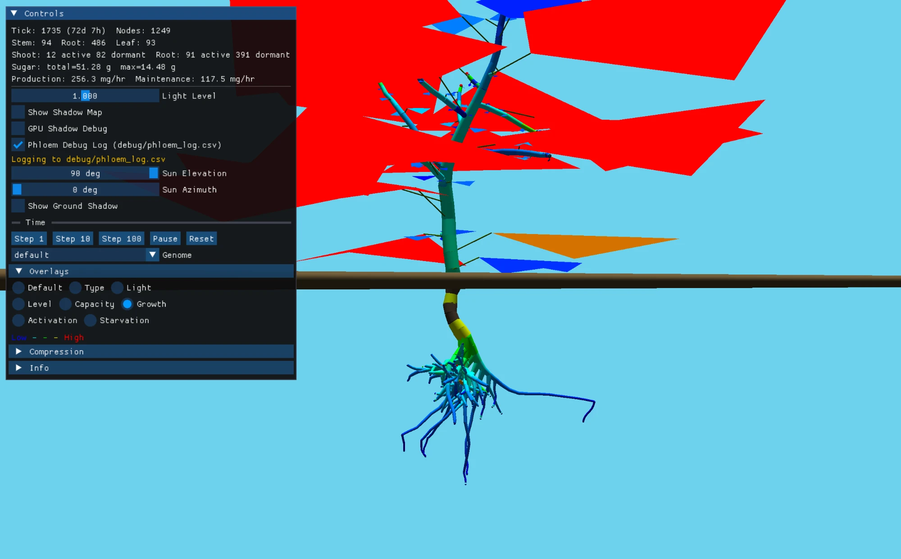
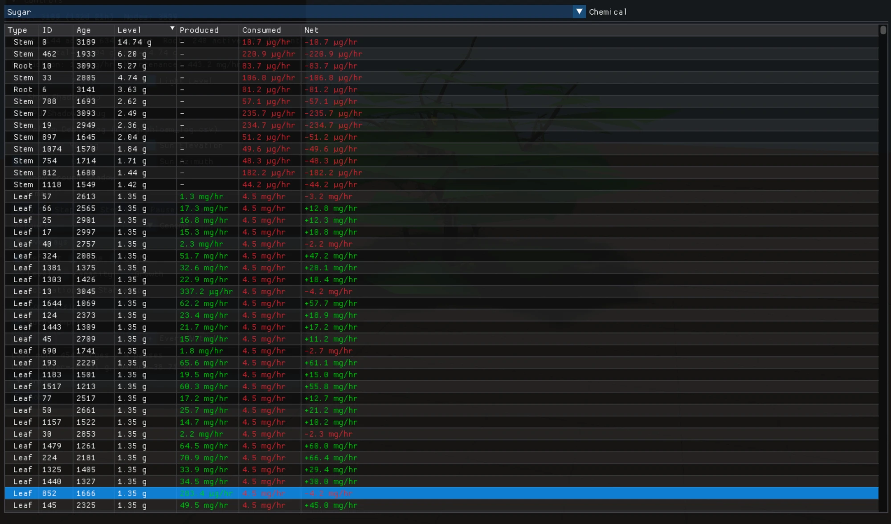

# Botany



A plant growth simulator where branching, thickening, and root architecture
emerge from a compartmented hormone-and-sugar economy, not from procedural
rules. Nothing in the engine decides "put a branch here" or "the trunk
should be thicker" — those are consequences of auxin flowing through PIN
transporters and driving cambium rate, cytokinin arriving in the xylem flow
from active root tips, and sugar being metered through phloem to meristems
that can afford to divide. Change the chemistry and the plant looks
different.

## Quickstart

```bash
./run.sh
```

That configures CMake, downloads a handful of C++ libraries (glm, GLFW,
glad, imgui, Catch2, and the companion [evolve](https://github.com/wldarden/evolve)
GA library) via FetchContent, builds, and opens the realtime viewer. First
run is a few minutes; subsequent runs are incremental.

Requires CMake 3.20+, a C++17 compiler, and OpenGL 4.1. Developed and
tested on macOS; Linux should work.

Click any node in the viewer to inspect its chemicals, flux, and growth
state in the right-hand Node Inspector. Color the plant by auxin,
cytokinin, sugar, gibberellin, or ethylene with the overlay radios.
Step individual ticks, pause, or let it run.

## Visual tour

| | |
|---|---|
|  |  |
| Day 40 — primary shoot and root chains, 183 nodes. The two leaves fund every meristem downstream of them. | Day 124 — same genome, ~3,400 nodes later. Shape is entirely emergent: 104 active shoot meristems with 391 held dormant by apical dominance. |



*Growth-rate overlay. Red = highest sugar-and-cytokinin availability for new tissue. The root system is as structurally interesting as the shoot — most of the mass is below ground until the trunk starts to thicken.*



*Per-leaf sugar economy, tick 3,000. Green rows are net producers, red are net sinks. Every per-tick flux is traceable to a specific node — the engine is instrumented end-to-end, which is how the design decisions below could be arrived at with any confidence.*

## Under the hood

A handful of design decisions worth calling out.

### Hormones drive morphology, not the other way around

Every node owns a `local_env` compartment holding auxin, cytokinin, sugar,
water, gibberellin, stress, and ethylene. Stems and roots additionally own
`phloem` and `xylem` pools, modelled as real transport conduits with
cross-sectional conductance derived from the node's radius. Specialty
nodes (leaves, meristems) reach their nearest ancestor's vasculature
through walk-up helpers — the same way a real leaf accesses the twig it
hangs from.

The plant's shape is downstream of this. Apical dominance isn't coded; it
falls out of a shoot apex emitting auxin, that auxin flowing basipetally
through PIN transporters, and axillary buds along the way sensing the
auxin on their parent stem to decide whether to activate. If the apex is
killed, auxin drops locally and the top-most dormant bud wakes up.

### Secondary thickening is PIN-saturation driven

A trunk forms because flow begets flow begets more cambium. Each
parent→child edge accumulates an `auxin_flow_bias` in `[0, 1]` — the
time-smoothed PIN saturation of that connection — and radial growth rate
is `cambium_responsiveness × auxin_flow_bias × sugar_fraction ×
stress_boost`. Lateral branches carrying little auxin flux never thicken;
the main axis, which routes most of the auxin from the canopy, thickens
fastest. There's no "node is old" or "node is on the trunk" check — the
bias ratchet is the gate.

### Sub-stepped vascular with a fixed propagation budget

Vascular transport runs after per-tick metabolism, as N iterations of
inject → longitudinal Jacobi equalization → radial exchange → extract.
Pressure fields are built from source/sink budgets frozen at the start of
the pass, and each Jacobi pass propagates by one hop along the conduit
chain. With a fixed N (default 25), plants whose longest source-to-sink
chain exceeds the budget show distance-dependent apical supply — distal
tips in a tall tree get less sugar than proximal ones.

That is biologically correct. Real tall trees have hydraulic limits.
Evolution can select for genomes whose radial-permeability curve and
tissue geometry fit within the N budget.

### Scaling invariant: no mechanism depends on auxin reaching a distant node

Auxin is deliberately local: 12% per-tick decay (half-life ~5.4 hours)
and transport limited to one hop per tick. Any mechanism that needed
auxin to reach a distant node would silently break beyond ~5–20
internodes. The engine is built around this constraint — cytokinin
production at root tips is a function of local sugar and water (not
coupled to auxin), root tip elongation gates on local cytokinin (not on
shoot-delivered auxin), dormant lateral buds sense cytokinin in their
parent's xylem rather than in their own local compartment.

This is what lets the same engine run a 1 dm seedling and a 5.8 m tree
without the latter collapsing into "distal apices starve themselves to
death." It was a mid-project architectural change — the full writeup is
in [docs/superpowers/specs/2026-04-20-hormone-biology-tree-scale-design.md](docs/superpowers/specs/2026-04-20-hormone-biology-tree-scale-design.md).

### Evolution with eight fitness objectives

A separate [evolve](https://github.com/wldarden/evolve) GA runs populations
of 20–200 plants in parallel threads, scores each on a weighted
combination of survival, biomass, leaf area, sugar reserves, height,
crown ratio, branch depth, and leaf-height spread, and iterates with
tournament selection, elitism, and per-gene mutation. Weights are live
sliders — change what you select for, watch the population shift. Genes
are grouped into eight linkage groups (auxin, cytokinin, shoot growth,
root growth, geometry, sugar economy, gibberellin, ethylene) so
crossover inherits coherent trait bundles.

### Deep shadow maps with soft penumbras

Leaf occlusion is physically meaningful (lower light → lower sugar
production → eventual ethylene-driven abscission), so the renderer has to
actually model it. GPU opacity shadow maps with power-curve slice
distribution, five samples per leaf for soft penumbras, arbitrary sun
angle, ground plane that casts and receives.

## Architecture

The engine (`src/engine/`) has no graphics dependencies and is built as a
static library; the renderer, serializer, and evolution system link
against it independently. Five node types (stem, root, leaf, shoot
apical, root apical) inherit directly from `Node` — flat hierarchy,
downcast through a `NodeType` enum rather than RTTI. Each node has a
non-virtual `tick()` and a virtual `update_tissue()`; tissue-specific
growth lives in the subclass.

Five apps share the engine:

- `botany_realtime` — the interactive viewer
- `botany_headless` — fast precomputed sims, writes playback recordings
- `botany_playback` — scrubbing viewer for recordings
- `botany_evolve` — the GA app, live population + fitness plots
- `botany_sugar_test` — a frozen-tree harness for validating the sugar economy

Plus a `.tree` snapshot format for loading a specific plant from disk,
and a lossy node-compression pass that merges adjacent stem/root nodes
sharing orientation and radius (optional per-tick, keeps long-horizon
sims tractable).

218 Catch2 tests cover node mechanics, transport, meristem lifecycle,
cytokinin flow, vascularization, compression, and the evolution system.

Deep technical reference — tick control flow, chemical transport table,
every tuning parameter with its biological role — is in
[CLAUDE.md](CLAUDE.md).

## Running the other apps

```bash
# Realtime viewer, color-coded by hormone
./build/botany_realtime --color auxin

# Realtime viewer, load a saved plant
./build/botany_realtime --load-plant saves/plant_<timestamp>.tree

# Headless sim with per-tick economy log
./build/botany_headless 10000 /tmp/rec.bin --economy-log /tmp/econ.csv

# Scrub through a recorded sim
./build/botany_playback /tmp/rec.bin

# Evolution — set weights, watch 50 generations
./build/botany_evolve

# Tests
./build/botany_tests
```

Save the current plant in the realtime viewer with `Cmd+S` on macOS or
`Ctrl+S` elsewhere.

## Status

Active, long-running personal project. The engine behaves well across the
scaling range it has been validated against — seedling through ~5.8 m
tree / ~3,700 nodes over 10,000 ticks, with hormone gradients, canalization,
and vascular transport doing what the biology predicts. Known gaps —
notably the realtime viewer's chemical overlays reading only `local()`
values and missing per-tick flux counters on the vascular pools — are
listed in CLAUDE.md's "Known Issues" section.
